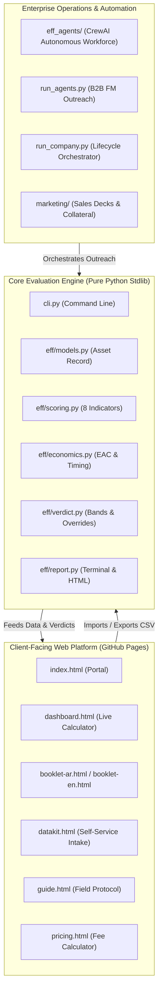

# eff — Equipment Fitness Framework

[](https://github.com/ahmedelshennawi1/EFF/actions/workflows/ci.yml)
[](https://ahmedelshennawi1.github.io/EFF/)
[](tests/test_eff.py)
[](cli.py)
[-brightgreen.svg)](eff/)
[](LICENSE)
[](index.html)

A scored, auditable engineering answer to one decision-grade question:

> **"Should this machine stay in service, be watched, be budgeted for replacement, or be retired now?"**

Most industrial operations answer this from nameplate age and gut feel. **eff** scores eight weighted degradation indicators, applies hard safety and physical overrides, runs a rigorous differential replacement-timing economic test, and reports exactly how much of the verdict is backed by genuine field measurements versus estimates.

Built with **pure Python (standard library only)** for the calculation engine, and accompanied by a **complete client-facing web application** hosted on GitHub Pages.

---

## 🌐 Live Web Platform (GitHub Pages)

Experience the full interactive suite directly in your browser:

| Module | Description | Live Link |
| :--- | :--- | :--- |
| **Portal & Overview** | Bilingual interactive landing page & framework overview | [**Launch Portal**](https://ahmedelshennawi1.github.io/EFF/) |
| **Interactive Dashboard** | Live fleet calculation engine, asset cards, and verdict explorer | [**Open Dashboard**](https://ahmedelshennawi1.github.io/EFF/dashboard.html) |
| **Executive Booklet (العربية)** | الدليل التنفيذي والفني لمنهجية تقييم كفاءة المعدات الصناعية | [**قراءة الكُتيب**](https://ahmedelshennawi1.github.io/EFF/booklet-ar.html) |
| **Executive Booklet (English)** | Executive technical whitepaper & decision methodology | [**Read Booklet**](https://ahmedelshennawi1.github.io/EFF/booklet-en.html) |
| **Field Measurement Guide** | Sensor protocols, instrument standards, and measurement cadence | [**Open Guide**](https://ahmedelshennawi1.github.io/EFF/guide.html) |
| **Data Collection Kit** | Self-service equipment intake form with instant CSV export | [**Open DataKit**](https://ahmedelshennawi1.github.io/EFF/datakit.html) |
| **Pricing Calculator** | Transparent assessment fee estimation & retainer calculator | [**View Pricing**](https://ahmedelshennawi1.github.io/EFF/pricing.html) |
| **Client Feedback** | Post-assessment review and service rating form | [**Give Feedback**](https://ahmedelshennawi1.github.io/EFF/feedback.html) |

---

## 🏗️ Architecture



---

## ⚡ Quick Start (Core Engine)

Zero external packages required to run the scoring engine:

```bash
# Clone the repository
git clone https://github.com/ahmedelshennawi1/EFF.git
cd EFF

# Run assessment across sample fleet
python cli.py
```

### Sample Output

```text
ASSET                                      SCORE  VERDICT            CONF  DRIVER
---------------------------------------------------------------------------------
CMP-02 · Screw compressor - packaging       59.4  Retire now         100%  EFFICIENCY
GEN-02 · Prime genset - hatchery            62.5  Plan replacement   100%  EFFICIENCY
MIL-07 · Hammer mill - feed line A          61.2  Plan replacement    85%  RELIABILITY
VEH-12 · Forklift - dispatch yard           53.5  Plan replacement   100%  MAINT_COST
PMP-04 · Irrigation pump - farm 3           47.6  Plan replacement   100%  EFFICIENCY
GEN-03 · Standby genset - cold store        15.4  Insufficient data   15%  AGE  (!)
CHL-01 · Chiller - process cooling          26.2  Monitor            100%  EFFICIENCY
GEN-01 · Standby genset - main feed plant    6.0  Keep               100%  EFFICIENCY
```

### Essential Commands

```bash
# Detailed breakdown per asset
python cli.py --detail

# Inspect a single asset
python cli.py --asset GEN-02

# Generate a branded executive HTML report
python cli.py --html out/assessment.html

# Assess a custom fleet CSV at a specific discount rate
python cli.py --data data/client-fleet.csv --rate 0.22

# Inspect machinery profiles for a specific sector
python cli.py --sector poultry

# Validate machinery library schema
python cli.py --check-library

# Run all 63 unit tests
python tests/test_eff.py
```

---

## 🔬 The 8 Degradation Indicators

EFF scores each asset on an auditable scale from **0** (*as-new*) to **100** (*consumed*):

1. **Life Consumption (AGE)**: Worse of calendar duration vs accumulated run-hours.
2. **Reliability**: Unplanned downtime hours and failure frequency (excluding scheduled maintenance).
3. **Efficiency Degradation**: Load-corrected specific energy consumption (kW/TR, L/kWh, kWh/ton) compared against baseline.
4. **Capacity Derating**: Inability to deliver rated output under standard ambient conditions.
5. **Maintenance Cost Burden**: Cumulative maintenance spend relative to new replacement value.
6. **Physical Condition**: Non-destructive examination, vibration severity, thermal signatures, and oil analysis.
7. **Supportability**: OEM parts availability, lead times, and controller obsolescence.
8. **Safety & Environmental**: Compliance gaps, statutory pressure vessel certification, and emissions leaks.

---

## ⚖️ Four Non-Negotiable Honesty Rules

1. **Missing data is never scored as zero:** Unmeasured indicators are excluded and weights redistributed. If confidence is below 60%, the framework issues **Insufficient data**, never an unearned *Keep*.
2. **Differential economics:** Only *excess* fuel/electricity and *excess* downtime beyond a new unit's baseline are charged against keeping the asset.
3. **Economics can recommend budgeting, never retirement:** An adverse economic test escalates the verdict by at most one band (capping at `PLAN_REPLACEMENT`). `RETIRE_NOW` strictly requires physical, safety, or severe degradation evidence.
4. **Overrides are floors, never demotions:** A safety hazard or regulatory failure forces an immediate escalation and cannot be averaged out by healthy indicators.

---

## 📦 Releases

| Release | Audience | Description | Documentation |
| :--- | :--- | :--- | :--- |
| **`v1.0.0` (Customer)** | Clients & Public | Clean client web platform, bilingual booklets, interactive dashboard, data kit, and pure Python evaluation engine. | [**Release Notes**](RELEASES.md#1-customer--public-release-v100) |
| **`v1.0.0-internal`** | Internal Team | Full enterprise stack: multi-agent autonomous sales crew (`eff_agents`), marketing decks, cold outreach playbooks, and company orchestrator. | [**Internal Guide**](docs/INTERNAL.md) |

---

## 📂 Repository Layout

```text
EFF/
├── index.html                   Client landing page & portal (PWA)
├── dashboard.html               Interactive fleet assessment dashboard
├── booklet-ar.html              Executive technical booklet (العربية)
├── booklet-en.html              Executive technical booklet (English)
├── guide.html                   Field measurement & instrumentation guide
├── datakit.html                 Self-service data collection kit
├── pricing.html                 Transparent service pricing calculator
├── feedback.html                Client satisfaction review form
├── manifest.json / sw.js        Progressive Web App (PWA) offline support
│
├── cli.py                       Command line interface
├── config.json                  Economic rates, thresholds, and defaults
│
├── eff/                         Core calculation engine (stdlib only)
│   ├── models.py                Asset record schema and CSV parsing
│   ├── profiles.py              Machinery archetypes & sector curves
│   ├── scoring.py               The 8 degradation indicator models
│   ├── economics.py             Equivalent Annual Cost & replacement timing
│   ├── verdict.py               Weighted roll-up, confidence, and overrides
│   └── report.py                Console and branded HTML reporting
│
├── data/
│   ├── profiles.json            Machinery library: 47 classes across 11 sectors
│   └── assets.csv               Demonstration fleet dataset
│
├── tests/
│   └── test_eff.py              63 unit tests (zero dependencies)
│
├── docs/
│   ├── CRITERIA.md              Full mathematical and engineering methodology
│   ├── DATA-COLLECTION.md       Field measurement manual & tool specifications
│   └── INTERNAL.md              Internal operations and agent crew manual
│
├── eff_agents/                  Autonomous Multi-Agent Crew (CrewAI)
│   ├── sales_crew.py            B2B Facility Management lead generation
│   ├── marketing_crew.py        Industrial content & value messaging
│   ├── data_ops_crew.py         Asset intake & anomaly validation
│   └── support_crew.py          Onboarding & advisory synthesis
│
└── marketing/                   Enterprise sales collateral & decks
    ├── Cold-Emails-FM.md        Targeted outreach for Egyptian FM leaders
    ├── EFF-Org-Chart-A0.html    A0-scale interactive corporate org chart
    └── EFF-Brochure-Print.html  Print-ready executive brochure
```

---

## 🛡️ License & Contributing

* **License:** Licensed under the [MIT License](LICENSE).
* **Contributions:** Please review [CONTRIBUTING.md](CONTRIBUTING.md) and our [Code of Conduct](CODE_OF_CONDUCT.md).
* **Security:** Review [SECURITY.md](SECURITY.md) to report vulnerabilities.
